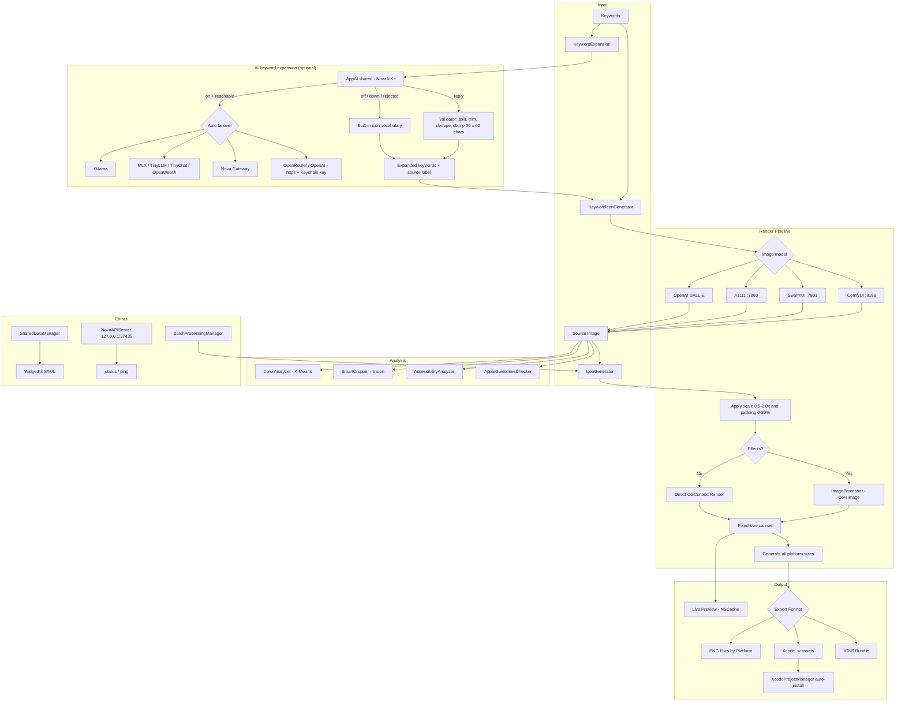
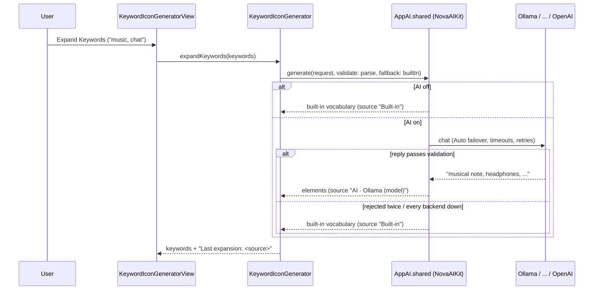
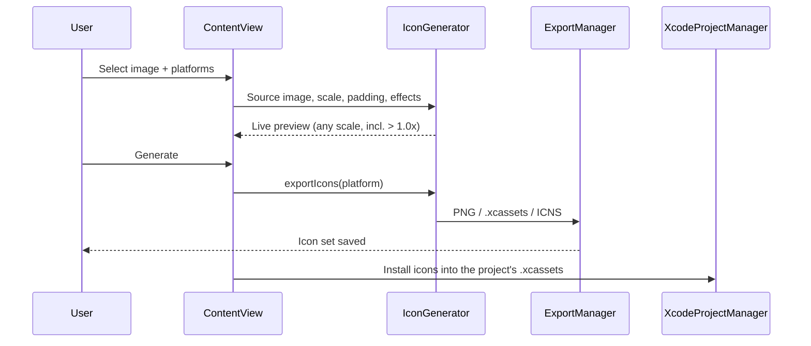

# Icon Creator


[](LICENSE)


**App icon generator for every Apple platform: one source image in, complete icon sets out. Batch processing, color
analysis, Xcode project install, screenshot resizing, image-model icon generation from keywords, and optional AI keyword
expansion through [NovaAIKit](https://github.com/kochj23/NovaAIKit).**

Icon Creator generates complete icon sets from a single source image for iOS, macOS, watchOS, tvOS, iMessage and Mac
Catalyst, exports PNG / `.xcassets` / ICNS, and installs straight into your Xcode projects. Keyword mode draws icons with
local or cloud image models (ComfyUI, SwarmUI, Automatic1111, OpenAI DALL-E). AI is optional everywhere: with AI off the
app does everything it did before, using its built-in icon vocabulary for keyword expansion.

Written by Jordan Koch.

> **2.7.0** — AI moved to **NovaAIKit 1.0.0**: one AI feature set shared by every Nova macOS app. AI on/off, backend
> picker (Auto, Ollama, MLX, TinyLLM, TinyChat, OpenWebUI, Nova Gateway, OpenRouter, OpenAI), model picker, editable
> URLs, keys only in the Keychain (`com.jkoch.iconcreator.*`, https only), a live status indicator, Auto failover with
> timeouts and retries, and validated replies with a built-in fallback. The old Google Cloud / Azure / AWS / IBM Watson
> backends and the in-app "Ethical AI Guardian" were removed; their stored secrets are deleted on first launch.

---

## Contents

- [Architecture](#architecture)
- [Features](#features)
- [AI (NovaAIKit)](#ai-novaaikit)
- [Requirements](#requirements)
- [Installation](#installation)
- [Building](#building)
- [Usage](#usage)
- [Test Suite](#test-suite)
- [Security and Privacy](#security-and-privacy)
- [Changelog](#changelog)
- [License](#license)

---

## Architecture



### AI request flow



### Export flow



---

## Features

### Icon generation

| Feature | Details |
|---|---|
| Platforms | iOS, macOS, watchOS, tvOS, iMessage, Mac Catalyst |
| Formats | PNG, ICNS, Xcode `.xcassets` (auto-created if the project has none) |
| Scaling | 0.5x-2.0x with bicubic interpolation; upscales clip at the canvas edge |
| Padding | 0-30% |
| Background | Solid color or gradient behind the icon |
| Auto-crop | Crop non-square images to square |
| Image effects | Brightness, contrast, saturation, Core Image filters, corner radius, shadow |

### Keyword icon generation (image models)

Draw icons from keywords with local or cloud image models. Configurable variant count, size and style.
Inspired by [VibeScape](https://github.com/jasonacox/VibeScape) by Jason Cox.

| Provider | Default URL | Notes |
|---|---|---|
| ComfyUI | `http://localhost:8188` | Node-based workflows |
| SwarmUI | `http://localhost:7801` | Flux models |
| Automatic1111 | `http://localhost:7860` | Stable Diffusion WebUI |
| OpenAI DALL-E | `https://api.openai.com` | API key entered per session (never written to disk) |

### AI keyword expansion

"Expand Keywords" turns a few words into concrete visual elements for the image prompt
("music" → "musical note, headphones, sound waveform, ..."). See [AI (NovaAIKit)](#ai-novaaikit).

### Batch processing

Queue multiple source images with per-item platforms and settings; process the queue with progress tracking.

### Color analysis

K-means clustering extracts dominant colors and suggests a palette (primary, secondary, accent, background); color
harmony generators (complementary, triadic, analogous, monochromatic, split-complementary, tetradic); WCAG contrast.

### Smart cropping, presets, guidelines, accessibility

- Vision face/object detection for crop positioning
- Presets (Minimalist, Full Bleed, Rounded, ...) saved and reloaded
- Apple Human Interface Guidelines checker
- Contrast / readability accessibility analyzer

### Xcode project integration

Scan configurable project locations, detect each project's platforms, and install generated icons into its
`.xcassets`.

### Screenshot resizer

Resize screenshots to App Store submission sizes for every platform.

### macOS widget (WidgetKit)

| Size | Content |
|---|---|
| Small | Quick create from last image, recent project |
| Medium | Recent projects, generation status |
| Large | Presets, projects and status dashboard |

Data syncs via App Group `group.com.jkoch.iconcreator`.

### Nova API server

Local HTTP API on port **37435**, loopback only, no CORS header.

```bash
curl http://127.0.0.1:37435/api/status
curl http://127.0.0.1:37435/api/ping
```

---

## AI (NovaAIKit)

Icon Creator's chat AI runs on [NovaAIKit 1.0.0](https://github.com/kochj23/NovaAIKit), the shared AI layer of the Nova
macOS apps. The app keeps no AI client code of its own.

| | |
|---|---|
| Where | Toolbar **AI Config** button, or **Icon Creator › Settings… › AI** (⌘,) |
| On/off | "Use AI" toggle. Off = nothing is sent anywhere; the built-in behaviour is used |
| Backends | Auto (failover), Ollama, MLX, TinyLLM, TinyChat, OpenWebUI, Nova Gateway, OpenRouter, OpenAI |
| Models / URLs | Model picker (lists the server's installed models) and editable URL per backend, connection test |
| Keys | Keychain only: `com.jkoch.iconcreator.openrouter`, `com.jkoch.iconcreator.openai`, ... (account `apiKey`). Shown as "stored", never as text. Sent only over https |
| Reliability | Auto failover across reachable backends, per-request timeouts, retries with backoff on transient errors |
| Status | `NovaAIStatusIndicator` in the toolbar and the Keyword Generator header: green = online, orange = unreachable, grey = off. Click to re-check |
| Validation | Every reply is checked before use; a rejected reply is retried once with the reason, then the fallback is used |

| Feature | With AI | When AI is off / unreachable / rejected |
|---|---|---|
| Expand Keywords | Comma-separated visual elements from the model, split, trimmed, de-duplicated, max 30 items of 60 characters | Built-in icon vocabulary (about 40 themes: music, security, weather, finance, ...); unknown words become "<word> symbol / silhouette" |

The Keyword Generator header shows where the last expansion came from ("AI · Ollama (qwen3:8b)" or "Built-in").

Image generation (ComfyUI / SwarmUI / Automatic1111 / DALL-E) is not chat AI and is unchanged.

**Migration (first launch of 2.7.0):** the old backend choice, Ollama model and TinyLLM / TinyChat / OpenWebUI URLs are
imported; an OpenAI key from the old Keychain item (`com.jordankoch.IconCreator`) moves to
`com.jkoch.iconcreator.openai` and the old item is deleted; the removed Google Cloud / Azure / AWS / IBM Watson secrets
are deleted from the Keychain and any plaintext leftovers in UserDefaults are removed.

---

## Requirements

- macOS 14.0 (Sonoma) or later, Apple Silicon or Intel
- Optional, for AI keyword expansion: any NovaAIKit backend (e.g. [Ollama](https://ollama.com) on `localhost:11434`)
- Optional, for keyword icon drawing: ComfyUI, SwarmUI, Automatic1111, or an OpenAI API key

## Installation

### From DMG

Open `IconCreator-v2.7.0-build5.dmg` (from [Releases](https://github.com/kochj23/icon-creator/releases) or the local
binaries share) and drag **Icon Creator** onto **Applications**. Release builds are ad hoc signed for local use; on first
launch, right-click › Open.

### From source

```bash
git clone git@github.com:kochj23/icon-creator.git
cd icon-creator
open "Icon Creator.xcodeproj"   # Swift Package Manager resolves NovaAIKit automatically
```

## Building

```bash
# Release build (zero warnings)
xcodebuild -project "Icon Creator.xcodeproj" -scheme "Icon Creator" -configuration Release -derivedDataPath ./dd build

# Tests
xcodebuild -project "Icon Creator.xcodeproj" -scheme "Icon Creator" -derivedDataPath ./dd test
```

Dependencies: [NovaAIKit](https://github.com/kochj23/NovaAIKit) `from: 1.0.0` (Swift Package). The optional `CLI/`
package builds separately with `swift build`.

---

## Usage

1. Launch Icon Creator and drop a source image (PNG, JPEG) onto the window
2. Choose target platforms
3. Adjust scale, padding, background and effects; watch the live preview
4. Generate, then export to a folder, `.xcassets` or ICNS, or install straight into an Xcode project

### Keyword mode

1. Toggle **Keyword Generator** in the toolbar
2. Enter keywords (and optionally the app name)
3. **Expand Keywords** (AI or built-in vocabulary), pick an image provider, generate variants
4. Install the one you like into a project

### Batch mode

1. Toggle **Batch Mode**, add images to the queue, set per-item platforms
2. Process the queue

---

## Test Suite

209 tests, all passing, grouped in 7 categories.

```bash
xcodebuild -project "Icon Creator.xcodeproj" -scheme "Icon Creator" -derivedDataPath ./dd test
```

| Category | Tests | Covers |
|---|---|---|
| Unit | 72 | Platforms and sizes, icon settings, color components, effects, generator core, keyword-expansion parser and built-in vocabulary, backend set |
| Functional | 56 | Presets, color harmony/palettes, screenshot sizes, variants, slider sweep, AI off / offline keyword expansion, toggle persistence |
| Frame / UI state | 33 | Views construct and render, AI settings sheet and status indicator, status = off when AI is disabled, source labels |
| Security | 23 | Keychain service names, keys never in settings/UserDefaults, no key over http, legacy Keychain migration + obsolete-secret deletion, no legacy AI client code, path traversal, CORS |
| Integration | 14 | Export to disk, preview cache, AI reply used when valid, legacy settings import (backend, model, URLs), removed clouds → Auto, idempotent migration |
| Performance | 6 | Icon-set render bound, cache hit, built-in expansion and parser speed, offline fallback does not hang |
| Retry | 5 | Invalid geometry fails gracefully, typed export errors, rejected AI reply retried once then fallback, transient 503 retried |

AI tests (`Icon CreatorTests/AIKitAdoptionTests.swift`) never use the real Keychain or network: in-memory settings and keys
and a stub `URLProtocol`.

---

## Security and Privacy

- **Local processing**: all image manipulation happens on your Mac
- **No telemetry**
- **AI is optional**: off = nothing leaves the Mac for keyword expansion
- **Keys in the Keychain only** (`com.jkoch.iconcreator.*`), never in UserDefaults, files or the environment; refused over plain http
- **Loopback-only API**: the Nova server binds to 127.0.0.1 and sends no wildcard CORS header

---

## Changelog

See [CHANGELOG.md](CHANGELOG.md).

## License

MIT License -- Copyright 2026 Jordan Koch. See [LICENSE](LICENSE).

---

Written by Jordan Koch ([@kochj23](https://github.com/kochj23))
